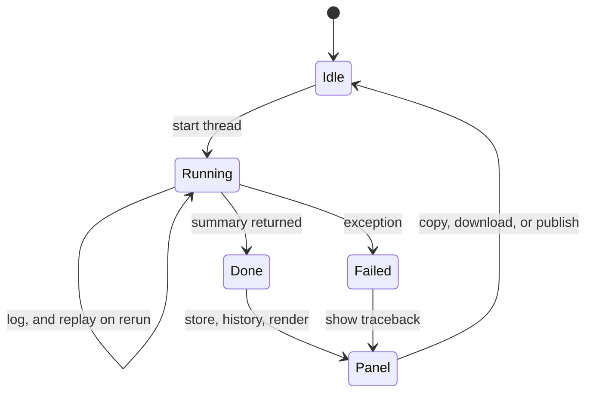

# Webapp

The Streamlit GUI runs at `http://localhost:8501` and provides a point-and-click interface to all summarizer features.

```bash
python -m streamlit run app.py
```

## Supported Inputs

| Type | Examples |
|------|----------|
| Video files | `.mp4`, `.mp3`, `.wav`, `.m4a`, `.webm` |
| Text files | `.txt`, `.md`, `.vtt`, `.srt`, `.csv`, `.log`, `.rst`, `.html`, `.xml`, `.json` |
| URLs | YouTube, Instagram, TikTok, Twitter/X, Reddit, Facebook, Google Drive, Dropbox |

Text files bypass audio processing entirely and go straight to summarization.

Paste a link in the **URL** tab, or drop a file in the **File** tab, then press **Run**. The File tab also has **Paste from clipboard**, which summarizes pasted text as a `.txt` source, and **Clear**, which drops the current file.

After running a source, switch between **Summary** and **Transcript**. The transcript tab shows the complete cached transcript when available (not the passages selected by JEV). **Download**, **Copy to clipboard**, and **Publish** (share on tinypaste) use whichever tab is selected. If no transcript is available for a result, the transcript actions are hidden. Summaries restored from disk do not include their transcripts.

## Job Lifecycle

Each run executes on a background thread, so rerunning the page replays progress instead of restarting the work. Finished runs are stored in history, rendered in the summary panel, and can be copied, downloaded, or published.



## Sidebar Controls

- **Theme** — **Auto** (follows your system), **Light**, or **Dark**
- **Provider** — Choose from configured providers in `summarizer.yaml`. The line under it shows the provider's model, chunk size, and parallel calls, all set in `summarizer.yaml`.
- **Style** — Summary style from `prompts.json`
- **Language** — Transcript language: Automatic, English, Spanish, French, German, Italian, Portuguese, Chinese, Japanese, Korean
- **Output language** — Language of the generated summary; `auto` leaves the prompt unchanged
- **Use JEV prefiltering** — Reveals the scoring provider and **I want to include only…** / **I want to exclude…** fields. See [JEV Prefiltering](jev-prefiltering).

**Settings** holds the less common options:

- **Verbose output** — Detailed progress, including fallback attempts
- **Force audio download** — Skip captions and transcribe the audio instead
- **Transcription** — Cloud Whisper or Local Whisper
- **Whisper model** — Only used with Local Whisper
- **Speed** — Playback speed for audio preprocessing or visual-mode video (reduces transcription cost, may reduce accuracy)
- **Visual mode** — Toggle video-direct mode
- **Transcript sidecar** and **Sidecar order** — An external service that fetches the transcript of a video URL, used as a fallback or first. **Sidecar order** is disabled while the sidecar is **None**. See [Transcript Sidecar](../integrations/transcript-sidecar).

Unlike the other controls, the two sidecar choices are saved to `summarizer.yaml` as soon as you change them. They survive reconnects and become the default for the CLI and HTTP API too. Without a `summarizer.yaml`, they last for the session only.

**Edit config** opens `summarizer.yaml` in the sidebar; **Save** applies it to all defaults above.

## History

The sidebar keeps the last 10 summaries. By default, history is **in-memory only** and is lost on page refresh.

Persist summaries to disk so they survive refreshes and container restarts:

```yaml
defaults:
  keep-history: true
  output-dir: summaries
```

Or set `SUMMARIZER_KEEP_HISTORY=true` when the YAML key is omitted (Docker Compose does this by default).

Docker deployments copy `summarizer.docker.yaml`, which enables `keep-history` out of the box. Summaries are written to `./summaries/` when using the default bind mount.

## Mermaid Diagrams

When a summary contains ` ```mermaid ` blocks, the webapp renders them as interactive diagrams with:

- **Wheel zoom** — Scroll to zoom in/out
- **Drag pan** — Click and drag to move around
- **Fullscreen** — Expand to full screen
- **Theme-aware** — Adapts to dark/light mode

## Clipboard

**Copy to clipboard** copies the selected summary or the full cached transcript with a single click, in both secure and non-secure browser contexts.

**Paste from clipboard** reads text into the File tab. Browsers only allow that in a secure context (HTTPS or `localhost`); elsewhere, the button asks you to press Ctrl+V in the paste field instead.

## Themes

Switch between **Auto** (follows your system), **Light**, and **Dark** at the top of the sidebar. The theme applies to the entire UI including Mermaid diagrams.
