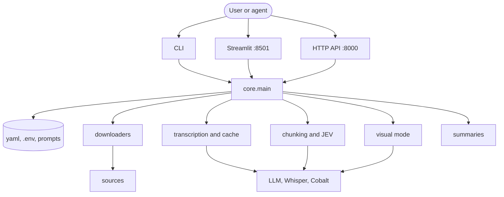
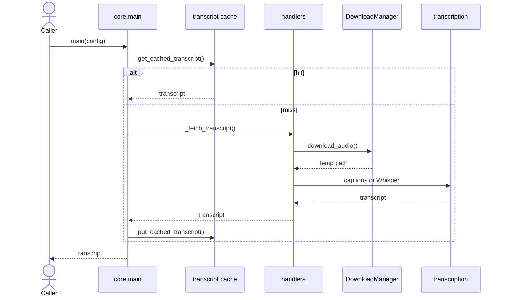
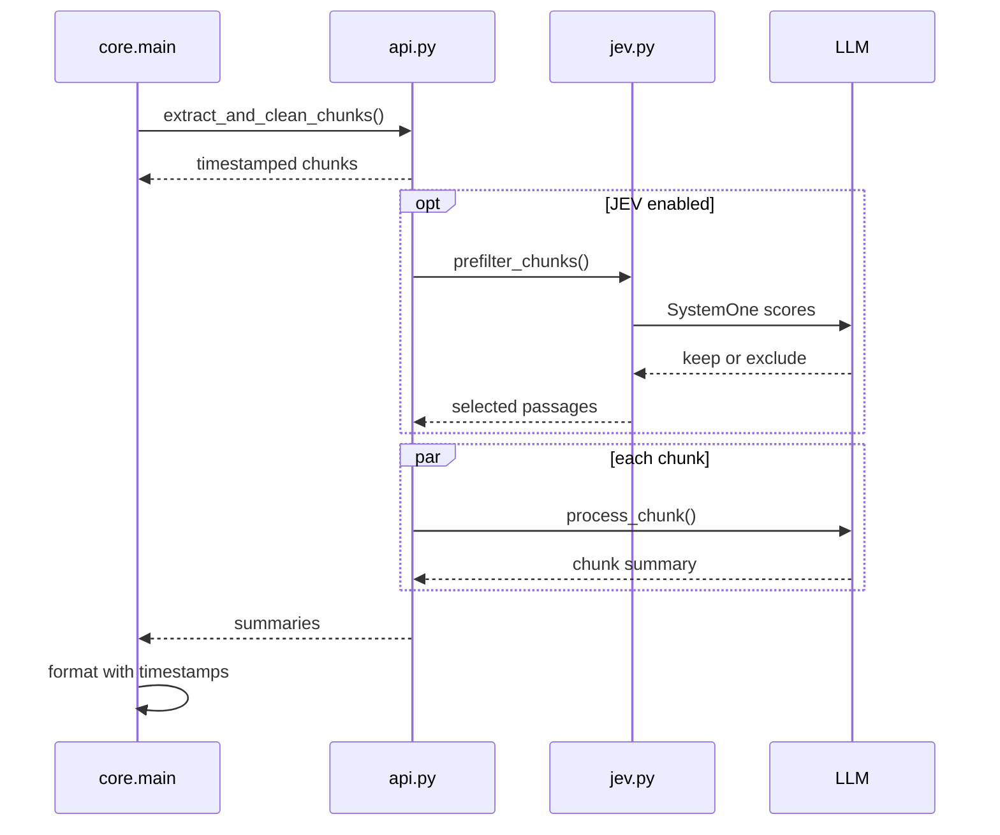

# How It Works

## Architecture

Three surfaces — the CLI, the Streamlit webapp, and the HTTP API — all drive the same engine.

## Pipeline

The default transcript path runs in two stages.

### 1. Acquire the transcript

Cache first, then the downloader fallback chain, then captions or Whisper.

### 2. Chunk, filter, summarize

## Download Pipeline

The app uses a **fallback downloader chain**:

1. **yt-dlp** — YouTube, Instagram, TikTok, Twitter/X, Reddit, Facebook
2. **YouTube** (`pytubefix`) — fallback if yt-dlp fails
3. **Cobalt** — fallback for other HTTP video URLs

If a downloader does not support a URL or fails, the next one is tried automatically.

## Key Files

| File | Purpose |
|------|---------|
| `summarizer.yaml` | Provider settings and defaults. Generate with `python -m summarizer --init-config`. |
| `.env` | API keys matched by URL keyword or conventional env var names |
| `summarizer/prompts.json` | Summary style templates |

## Processing Paths

- **Transcript path** (default): downloads audio/video, transcribes with Whisper or captions, caches the complete transcript, optionally selects passages with JEV, then summarizes with an LLM.
- **Visual path** (`--visual`): sends the video directly to a vision-capable model, skipping transcription. Uses the same prompts, provider config, and `.env` keys as the transcript path. Supports `base64` chunks (default) and `url` passthrough for YouTube.

See [Visual Mode](../features/visual-mode) for provider setup and [Transcription](../features/transcription) for Whisper options.

## Notes

> **Tip:** If YouTube captions are unavailable, the tool automatically falls back to audio download + Whisper transcription.
>
> **Tip:** Transcripts are cached in memory by default. Re-summarizing the same source with a different style, provider, or JEV selection skips transcription entirely. Disable with `cache-transcript: false` in `summarizer.yaml`.

- Cloud Whisper uses **Groq Cloud API** and requires a Groq API key.
- The Docker image does **not** include Local Whisper and is aimed at lightweight VPS deployment.
