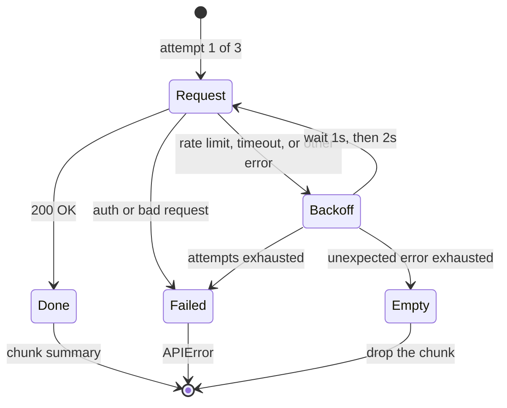

# Retry Behavior

The API layer automatically retries on transient failures:

- **Rate limits** — 3 attempts with backoff
- **Timeouts** — 3 attempts
- **Authentication errors** — Fail immediately
- **Bad requests** — Fail immediately

> **Tip:** Use `--verbose` to see the retry attempts in real time.
